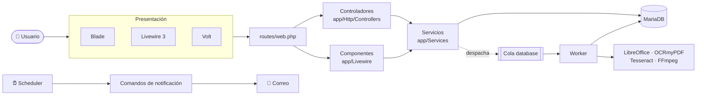

<div align="center">

# ⚖️ 4toTOP · Sistema de Oficios y Libertades

**Plataforma interna del 4° Tribunal de Juicio Oral en lo Penal de Santiago**

Oficios, libertades, turnos, audiencias, insumos y herramientas de oficina en una sola aplicación web.


</div>

---

## 📑 Contenido

- [Qué hace](#-qué-hace)
- [Módulos](#-módulos)
- [Arquitectura](#-arquitectura)
- [Stack](#-stack)
- [Puesta en marcha](#-puesta-en-marcha)
- [Tareas programadas y colas](#-tareas-programadas-y-colas)
- [Pruebas y calidad](#-pruebas-y-calidad)
- [Despliegue en producción](#-despliegue-en-producción)
- [Estructura del proyecto](#-estructura-del-proyecto)
- [Documentación adicional](#-documentación-adicional)

## 🎯 Qué hace

El sistema tiene dos caras:

| | Front office (público interno) | Backoffice (con sesión) |
|---|---|---|
| **Para quién** | Todo el personal del tribunal | Funcionarios con roles y permisos |
| **Qué ofrece** | Turnos del día, guías telefónicas, accesos directos, programación diaria, procedimientos, documentos, buscador de sentencias, ausencias, mapa de servicios, conversión de archivos | Gestión de oficios y libertades, turnos, audiencias, funcionarios, insumos, inventario, visitas a cárcel, seguridad y auditoría |
| **Entrada** | `/` (portada con turnos) | `/dashboard` |

## 🧩 Módulos

<details open>
<summary><b>📄 Oficios y libertades</b></summary>

- Solicitud y registro de oficios y libertades, con numeración correlativa automática (`AsignadorNumeroOficio`, `AsignadorNumeroLibertad`).
- Tablas de seguimiento en Livewire (`OficioTabla`, `LibertadTabla`).
- Rutas: `SistOficioLibertades.*`, `/oficiolibertad`.

</details>

<details>
<summary><b>🗓️ Turnos, audiencias y programación</b></summary>

- Turnos del tribunal y TTYPP (testigos y peritos), con exportación a Excel.
- Audiencias diarias, cambio de estado, cargas masivas de audiencias cortas y lecturas de sentencia.
- Monitor de audiencias en pantalla (`/Monitor`) y envío de la programación diaria por correo.
- Audios de salas, con recorte de audio.

</details>

<details>
<summary><b>👥 Personas y asistencia</b></summary>

- Funcionarios (`/addfuncionario`), ausencias y ausentismo con calendario.
- Cumpleaños, con saludo automático por correo.
- Guías telefónicas.

</details>

<details>
<summary><b>📦 Insumos, inventario y servicios</b></summary>

- Insumos: solicitudes, gestión, inventario, importación desde Excel, reportes y campana de notificaciones.
- Inventario de servicios y activos, con exportación.
- Mapa de servicios, en versión pública y de backoffice.

</details>

<details>
<summary><b>🚔 Visitas a cárcel y bitácora de pruebas</b></summary>

- Registro de visitas a cárcel con exportaciones por penal.
- Bitácora de pruebas, pública y de backoffice.

</details>

<details>
<summary><b>🛠️ Herramientas de oficina</b></summary>

- **Convertir archivos** (`/convertir-archivos`): OCR, comprimir, Word a PDF, imagen a PDF, números de página, rotar, organizar, unir, dividir, PDF a Word y M4A a MP3. Se procesan en cola (`ConvertFile`) y se limpian cada hora.
- Buscador de sentencias, documentos, procedimientos, accesos directos y migración UNIJUD.

</details>

<details>
<summary><b>🔐 Seguridad</b></summary>

- Roles, permisos por rol, asignación de usuarios y auditoría (`/seguridad/*`).
- Permisos con `spatie/laravel-permission`; la visibilidad del menú usa permisos `navbar.*.visible`.
- Cabeceras de seguridad globales (`SecurityHeaders`).

</details>

## 🏗️ Arquitectura

Monolito Laravel separado en capas:



| Capa | Dónde vive | Notas |
|---|---|---|
| Presentación | `resources/views`, `app/Livewire` | Volt monta `resources/views/livewire` y `resources/views/pages`; la autenticación usa `pages.auth.*` |
| HTTP | `routes/web.php`, `app/Http/Controllers` | `/` llama a `TurnoController::enviarTurno` |
| Negocio | `app/Services` | Numeración, insumos, conversiones, catálogos, importadores Excel |
| Seguridad | `AppServiceProvider`, `app/Http/Middleware` | Spatie Permission; el rol `SuperAdmin` tiene acceso total |
| Persistencia | `database/` | MariaDB con Eloquent y Query Builder |
| Asíncrono | `app/Jobs`, `app/Console/Commands` | Cola `database` y scheduler |

## 🧰 Stack

| Área | Tecnología |
|---|---|
| Backend | PHP 8.3+, Laravel 13, Laravel Breeze |
| UI reactiva | Livewire 3, Volt |
| Estilos | Tailwind CSS 3 sobre Bootstrap 5.3 (solo CSS) |
| Frontend | Vite 6, jQuery, SweetAlert2, Font Awesome, PDF.js, wavesurfer.js |
| Datos | MariaDB, PhpSpreadsheet, Yajra DataTables |
| Correo | Mailers SMTP propios y Webklex IMAP |
| Pruebas | Pest 4, PHPUnit 12, Laravel Pint |
| Herramientas externas | LibreOffice, OCRmyPDF, Tesseract, Ghostscript, Poppler, FFmpeg |

## 🚀 Puesta en marcha

**Requisitos:** PHP 8.3+, Composer, Node.js, MariaDB. Las herramientas de conversión (LibreOffice, OCR, FFmpeg) solo hacen falta para `/convertir-archivos`.

```bash
# 1. Dependencias
composer install
npm install

# 2. Entorno
cp .env.example .env
php artisan key:generate

# 3. Base de datos (ajusta DB_* en .env)
php artisan migrate
php artisan db:seed --class=RolesAndPermissionsSeeder

# 4. Levantar todo
composer run dev
```

`composer run dev` levanta en paralelo el servidor HTTP, el worker de la cola `database`, Pail (logs), Vite y el scheduler.

> [!TIP]
> Para trabajar solo en el frontend basta con `npm run dev`; para generar los assets de producción, `npm run build`.

Comandos útiles:

```bash
php artisan db:seed --class=NombreDelSeeder   # ejecutar un seeder puntual
php artisan conversions:check                 # verificar herramientas de conversión
```

## ⏰ Tareas programadas y colas

Definidas en `routes/console.php` (zona horaria `America/Santiago`):

| Comando | Cuándo | Qué hace |
|---|---|---|
| `notificaciones:cumpleanos` | Diario, 08:00 | Saludo de cumpleaños |
| `notificaciones:ausentismo-diario` | Diario, 08:03 | Resumen de ausentismo del día |
| `notificaciones:visita-carcel-revision-pp` | Lun, mié y vie, 08:05 | Revisión de visitas a cárcel |
| `notificaciones:ttypp-diario` | Lunes a viernes, 08:10 | Resumen de testigos y peritos |
| `conversions:clean` | Cada hora | Elimina archivos convertidos vencidos |
| `weather:refresh` | Cada 15 minutos | Actualiza el clima de Santiago |

Worker de la cola en desarrollo, si no usas `composer run dev`:

```bash
php artisan queue:work database --queue=default -v
```

## ✅ Pruebas y calidad

> [!IMPORTANT]
> Las pruebas usan **MySQL/MariaDB**, no SQLite: `phpunit.xml` apunta a la base `sistoficiolibertades_test`, que debe existir antes de correrlas. Todas las pruebas de Feature usan `RefreshDatabase`.

```bash
./vendor/bin/pest                                # toda la suite
./vendor/bin/pest tests/Feature/TurnoRolesValidationTest.php
./vendor/bin/pest --filter="nombre del test"
./vendor/bin/pint --test                         # formato (Laravel Pint)
```

No hay lint ni typecheck de JavaScript configurados.

## 🌐 Despliegue en producción

Producción necesita, además del servidor web:

1. **Scheduler:** una entrada cron que llame a `schedule:run` cada minuto (es obligatoria para las notificaciones de las 08:00).

   ```bash
   * * * * * php /ruta/proyecto/artisan schedule:run >> /dev/null 2>&1
   ```

2. **Worker de cola** permanente sobre la conexión `database`. En Windows se puede instalar como servicio con NSSM (ver [PlanNSSMQueueWorkerWindows.md](docs/documentacion/PlanNSSMQueueWorkerWindows.md)).
3. **Assets compilados** con `npm run build` (`public/build`).
4. **Herramientas de conversión**, si se usa `/convertir-archivos`. Para servidores sin internet hay un paquete offline: ver [despliegue-herramientas-pdf.md](docs/despliegue-herramientas-pdf.md).

## 🗂️ Estructura del proyecto

```text
app/
├── Console/Commands/   # notificaciones, limpieza, importaciones
├── Http/Controllers/   # controladores (algunos legacy en minúscula: no renombrar)
├── Jobs/               # ConvertFile
├── Livewire/           # páginas y componentes reactivos
└── Services/           # lógica de negocio
resources/
├── css/app.css         # Bootstrap + Tailwind
├── js/app.js           # expone jQuery, Swal y SwalToast globales
└── views/              # Blade, Livewire y Volt (pages/)
routes/
├── web.php             # todas las rutas HTTP
└── console.php         # tareas programadas
docs/                   # planes, auditoría y guías de despliegue
tests/                  # Pest (Feature y Unit)
```

## 📚 Documentación adicional

| Documento | Tema |
|---|---|
| [AGENTS.md](AGENTS.md) | Guía rápida del repositorio para desarrolladores y agentes |
| [docs/file-conversions.md](docs/file-conversions.md) | Herramientas de conversión de archivos |
| [docs/despliegue-herramientas-pdf.md](docs/despliegue-herramientas-pdf.md) | Instalación offline de las herramientas PDF |
| [docs/documentacion/HabilitacionAusentismo08-03.md](docs/documentacion/HabilitacionAusentismo08-03.md) | Notificación diaria de ausentismo |
| [docs/documentacion/UpgradeLaravel.md](docs/documentacion/UpgradeLaravel.md) | Actualización de Laravel |
| [docs/auditoria/](docs/auditoria/) | Auditoría ISO 27002:2022 y plan de hardening |

---

<div align="center">
<sub>Uso interno del 4° Tribunal de Juicio Oral en lo Penal de Santiago.</sub>
</div>
