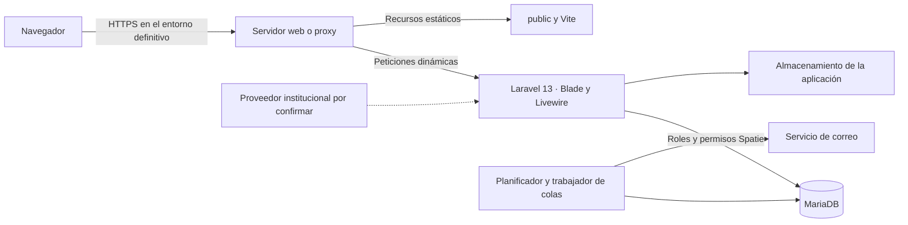

# Validación técnica de 4toTOP

Este documento describe la arquitectura que se puede verificar en el código y las evidencias que se deben obtener en el entorno definitivo. Registrar referencias a evidencias en el expediente de control de acceso correspondiente.

## Arquitectura

El navegador, el servidor web, la aplicación, la base de datos, el almacenamiento y los servicios institucionales son límites de confianza. Confirmar proxy, terminación TLS, discos, conexiones, identidades de servicio y topología antes de aprobar el diagrama del despliegue.

## Ficha de inventario

| Componente | Datos a registrar | Estado |
|---|---|---|
| Aplicación y trabajador | Versión PHP, artefacto, CPU asignada y uso pico, RAM asignada y uso pico, identidad de servicio y ubicación | Pendiente de infraestructura |
| Base de datos | Motor y versión efectiva, CPU y RAM, almacenamiento asignado/usado, crecimiento por mes, capacidad y fecha de proyección | Pendiente de infraestructura |
| Archivos, registros y respaldos | Discos y responsables, capacidad y uso, incremento mensual, retención, destino y cifrado | Pendiente de infraestructura |
| Proxy, identidad y correo | Responsable, versión o servicio, segmentación, TLS, identidad de servicio y dependencias | Pendiente de infraestructura |
| Respaldos | Frecuencia, día, hora y zona horaria, retención, destino, alcance, RPO y RTO aprobados | Pendiente de infraestructura |

Para proyectar capacidad, medir el uso en intervalos regulares. Registrar el período de medición y el crecimiento mensual de base de datos, archivos y registros por separado. Acordar con operaciones el umbral que dispara una ampliación de capacidad.

## Modelo de amenazas y riesgos

| Flujo | Riesgo | Control y evidencia |
|---|---|---|
| Identidad a aplicación | Suplantación, sesión vigente tras una baja o asignación incorrecta de rol | SSO institucional, MFA según política, roles de mínimo privilegio y pruebas de alta, baja y revocación |
| Visitante a aplicación y recursos estáticos | Divulgación de información o acceso fuera del rol autorizado | Clasificación por dueño, matriz de acceso, descargas con autorización y pruebas por superficie |
| Aplicación y trabajadores a datos | Acceso a datos fuera de la identidad o segmento esperado | Permisos mínimos, separación de entornos, TLS y pruebas funcionales representativas |
| Archivos entrantes y exportaciones | Contenido no válido, acceso cruzado y agotamiento de recursos | Validación de formato y tamaño, autorización y límites de ejecución |
| Cadena de despliegue | Dependencias vulnerables o artefactos alterados | Análisis previo, artefacto ligado al commit y aprobación registrada |
| Producción a respaldos | Pérdida de datos, filtración o restauración fallida | Cifrado, retención, prueba aislada y medición de RPO/RTO |

En el registro de riesgos, asignar dueño, probabilidad, impacto, tratamiento, plazo y aceptación residual a cada riesgo. El dueño del proceso confirma la clasificación y la necesidad de mantener cada vista pública.

## Plan de pruebas y liberación

- Validar portada, documentos, procedimientos, buscador, planos, audiencias, oficios, turnos, inventario, conversión de archivos y backoffice. Usar perfiles de visitante, usuario sin permiso y usuario autorizado. Registrar caso, rol, resultado esperado, resultado observado y evidencia. Incluir endpoints de descarga, exportación y acciones Livewire.
- Verificar integración con identidad, MFA cuando aplique, baja y revocación, aislamiento entre entornos y cifrado en tránsito y en reposo. Revisar cabeceras en el proxy y en Laravel, incluyendo navegación de autenticación, descargas, redirecciones y recursos estáticos.
- Revisar recursos externos y navegación antes de habilitar `SECURITY_ENFORCE_COEP=true` en el entorno candidato. Verificar allí `CORP: same-origin`, `COOP: same-origin` y `COEP: require-corp`.
- Antes de producción, ejecutar análisis estático, auditoría de dependencias, revisión de secretos y pruebas automatizadas. Guardar versión de herramientas, fecha, alcance, commit, resultado y tratamiento de hallazgos.
- Usar un artefacto versionado y promover el mismo candidato probado. El proceso de despliegue debe registrar aprobación, migración, reinicio de trabajadores, verificación de salud, resultado y procedimiento de reversión. Confirmar sistema CI/CD, responsables y estrategia de migración con infraestructura.
- En el entorno definitivo, usar datos de prueba aprobados y registrar resultados por módulo. Obtener un acta con commit, ambiente, excepciones, fecha y firma de un revisor independiente. Coordinar con seguridad la revisión de producción bajo OWASP ASVS/WSTG y tramitar los hallazgos en el canal acordado.

## Monitoreo y restauración

Registrar propietario, umbral, canal y escalamiento de alertas para errores HTTP, autenticación, colas, planificador, capacidad y respaldos. Validar que una alerta de prueba llegue al canal operativo y quede asociada al servicio.

Para probar la restauración, seleccionar un respaldo autorizado, restaurar base de datos y archivos en un entorno aislado y verificar integridad y módulos críticos. Mantener correo y tareas externas deshabilitados en el entorno de prueba. Registrar hora del respaldo, punto recuperado, duración, diferencias frente a RPO/RTO, evidencia y aprobación.

## Aprovisionamiento

El seeder principal carga catálogos operativos. Para crear una cuenta de prueba en local, configura `LOCAL_TEST_USER_PASSWORD` fuera de Git y ejecuta `php artisan db:seed --class=LocalTestUserSeeder`. Para asignar el rol de administrador a la cuenta institucional existente, usa `php artisan ensure:superadmin`.
